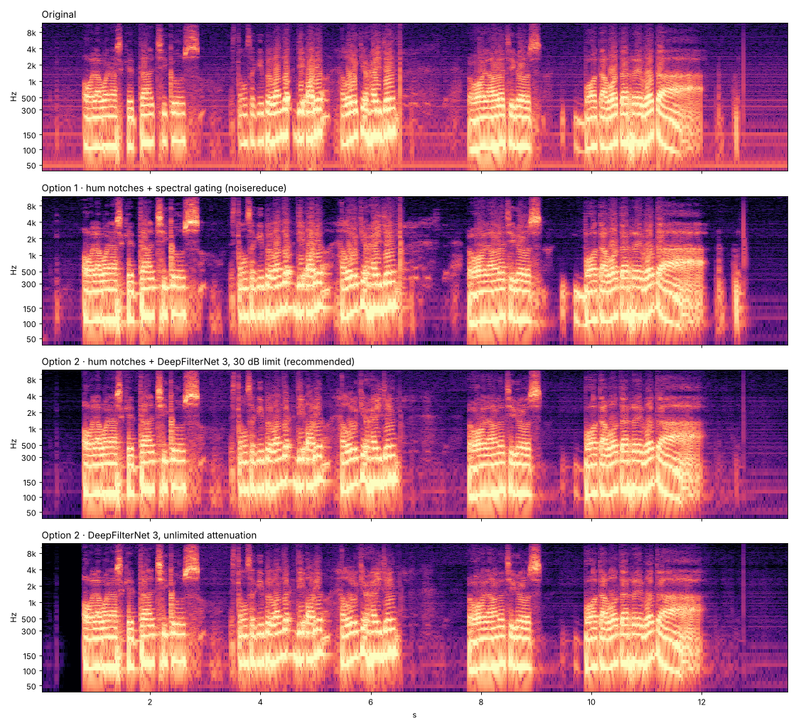

# audio-cleanup

Remove mains hum and background noise from long recordings (conference talks, podcasts, OBS captures), then normalize the loudness. The video is **never re-encoded**; only the audio track is replaced.

> **Used in production:** this tool was used to clean the audio of the **DevFest Ourense 2026** recordings (about 10 hours of talks with 50 Hz ground-loop hum and hiss).

It is designed to handle files of any length with constant memory use.



_Top to bottom: the original (horizontal lines at 50, 150, 350 Hz… are the hum), the lightweight `nr` engine, and DeepFilterNet at 30 dB (recommended). Audio samples are in [docs/samples](docs/samples)._

## Contents

- [What it does](#what-it-does)
- [Requirements](#requirements)
- [Quick start](#quick-start) ([Windows](#windows) · [Linux](#linux))
- [Usage](#usage)
- [How uv is used here](#how-uv-is-used-here)
- [Choosing a denoising engine](#choosing-a-denoising-engine)
- [OBS chapter markers and wrong durations](#obs-chapter-markers-and-wrong-durations)
- [Before running it on 10 hours](#before-running-it-on-10-hours)
- [Installing ffmpeg](#installing-ffmpeg)
- [Troubleshooting](#troubleshooting)
- [Use it as a Python library](#use-it-as-a-python-library)
- [Project layout](#project-layout) · [Contributing](#contributing) · [Alternatives](#alternatives-considered) · [License](#license)

## What it does

```
input.mp4 ──► decode (ffmpeg, mono 48 kHz, streamed)
          ──► 70 Hz high-pass + notch on every hum harmonic (frequency auto-detected, e.g. 49.8 Hz)
          ──► denoise in overlapping 30 s blocks      ◄── engine: df (DeepFilterNet) | nr (noisereduce)
          ──► clarity EQ + gentle compression + de-esser
          ──► two-pass EBU R128 loudness normalization (-16 LUFS, -1.5 dBTP)
          ──► remux with the original video (-c:v copy)  ──►  input_clean.mp4
```

1. **Hum removal.** The real mains frequency is detected from a noise-only stretch (found automatically in the first 10 minutes, or given with `--noise`). A narrow notch is placed on every harmonic up to 2.1 kHz.
2. **Denoising**, streamed in blocks so a 10 h file is never loaded in RAM:
   - `df` (default): **DeepFilterNet 3**, a neural network trained for speech. Best quality; faster with an NVIDIA GPU.
   - `nr`: stationary spectral gating ([noisereduce](https://github.com/timsainb/noisereduce)). CPU only and lightweight.
3. **Clarity**: −2 dB at 250 Hz (removes mud), +2.5 dB at 3.5 kHz (presence), light compression, de-esser.
4. **Loudness**: two-pass EBU R128 `loudnorm` to the target level (−16 LUFS by default, −14 for YouTube).
5. **Remux**: the original video stream is copied untouched; audio is AAC stereo at 192 kbps. OBS chapter markers are preserved (and repaired, see [below](#obs-chapter-markers-and-wrong-durations)).

The recording that motivated this project had **49.8 Hz hum with many (mostly odd) harmonics**, hiss around −50 dBFS and speech at about −16 LUFS with peaks at −7.5 dBFS, as dual-mono audio.

## Requirements

| What                                    | Notes                                                                                                  |
| --------------------------------------- | ------------------------------------------------------------------------------------------------------ |
| **Windows 10/11** or **Linux** (x86-64) | macOS is not tested.                                                                                   |
| **[uv](https://docs.astral.sh/uv/)**    | The setup scripts install it for you. It also downloads Python 3.11 by itself.                         |
| **ffmpeg + ffprobe** on `PATH`          | Windows: the setup script installs it with winget. Linux: see [Installing ffmpeg](#installing-ffmpeg). |
| ~3 GB of disk for the environment       | Almost all of it is PyTorch (only for the `df` engine).                                                |
| 2–3 GB free per 10 h of audio           | Temporary FLAC, deleted when finished. Change the location with `--workdir`.                           |

An NVIDIA GPU is optional: it makes `df` faster, and everything works on the CPU.

## Quick start

Get the code first:

```bash
git clone https://github.com/BobbyESP/audio-cleanup.git
cd audio-cleanup
```

### Windows

1. **Double-click `scripts\windows\setup.bat`** (one time). It installs uv and ffmpeg if they are missing, creates the Python environment and checks that everything works. If it installs ffmpeg, open a _new_ window and run it once more so Windows picks up the new `PATH`.
2. **Drag a video onto `scripts\windows\clean.bat`.** The result, `<name>_clean.mp4`, is written next to the original.

| Script                             | What it does                                                       |
| ---------------------------------- | ------------------------------------------------------------------ |
| `scripts\windows\setup.bat`        | One-time install and self-check. Safe to run again.                |
| `scripts\windows\clean.bat`        | Clean a video. Drag-and-drop, or pass options from a terminal.     |
| `scripts\windows\fix-duration.bat` | Fix a wrong duration in an already processed video. Drag-and-drop. |
| `scripts\windows\diagnose.bat`     | Timestamp report of one or more videos. Drag-and-drop.             |

### Linux

```bash
scripts/linux/setup.sh                      # one time; add --install-ffmpeg to also install ffmpeg (needs sudo)
scripts/linux/clean.sh /path/to/talk.mp4    # writes /path/to/talk_clean.mp4
```

| Script                                           | What it does                                                    |
| ------------------------------------------------ | --------------------------------------------------------------- |
| `scripts/linux/setup.sh`                         | One-time install and self-check. Safe to run again.             |
| `scripts/linux/clean.sh <video> [options]`       | Clean a video.                                                  |
| `scripts/linux/fix-duration.sh <video> [--drop]` | Fix a wrong duration in an already processed video.             |
| `scripts/linux/diagnose.sh [files...]`           | Timestamp report (default: every `.mp4` in the current folder). |

The scripts are thin wrappers around the `audio-cleanup` command, so everything below works the same on both systems.

## Usage

```bash
uv run audio-cleanup clean recording.mp4
uv run audio-cleanup clean recording.mp4 --atten 24 --lufs -14
uv run audio-cleanup clean recording.mp4 --engine nr --strength 0.8
uv run audio-cleanup clean recording.mp4 --audio-only        # only a clean .m4a
uv run audio-cleanup --help
```

On Windows use `scripts\windows\clean.bat "D:\path\recording.mp4" --atten 24` and on Linux `scripts/linux/clean.sh /path/recording.mp4 --atten 24`; the options are the same.

### Commands

| Command                              | Purpose                                                                                    |
| ------------------------------------ | ------------------------------------------------------------------------------------------ |
| `audio-cleanup clean <input>`        | The whole pipeline described above.                                                        |
| `audio-cleanup fix-chapters <input>` | Rewrite the chapter markers of a video so players show the right duration. No re-encoding. |
| `audio-cleanup diagnose [files…]`    | Durations, start times and timestamp gaps of each stream.                                  |
| `audio-cleanup doctor`               | Check ffmpeg and which denoising engines work.                                             |

### Options of `clean`

| Option              | Default             | What it does                                                                                                                                                   |
| ------------------- | ------------------- | -------------------------------------------------------------------------------------------------------------------------------------------------------------- |
| `-o, --output FILE` | `<input>_clean.mp4` | Output file.                                                                                                                                                   |
| `--engine {df,nr}`  | `df`                | Denoising engine, see [below](#choosing-a-denoising-engine).                                                                                                   |
| `--atten DB`        | `30`                | `df`: maximum attenuation. `18`–`24` keeps some room tone and sounds more natural; `100` removes as much as possible.                                          |
| `--strength 0–1`    | `0.9`               | `nr`: how much noise to remove.                                                                                                                                |
| `--lufs LUFS`       | `-16`               | Target loudness. −16 for speech/podcasts, −14 for YouTube.                                                                                                     |
| `--noise START-END` | automatic           | Noise-only stretch, e.g. `00:12:03-00:12:06`. By default silences are searched in the first 10 minutes. With `df` it is only used to detect the hum frequency. |
| `--chunk SECONDS`   | `30`                | Processing block length.                                                                                                                                       |
| `--audio-only`      | off                 | Write only a clean `.m4a`; do not touch the video.                                                                                                             |
| `--workdir DIR`     | next to the output  | Where intermediate files go. Use a fast disk with 2–3 GB free per 10 h.                                                                                        |
| `--keep`            | off                 | Keep intermediate files (the denoised FLAC and chapter file).                                                                                                  |
| `-v, --verbose`     | off                 | (global, before the command) debug logging.                                                                                                                    |

**Time and disk space:** on a 2-core test machine it ran at about 23× real time, roughly 25–30 minutes for 10 hours. More cores or a GPU make it faster. Besides the output video, which is about the same size as the original, you need the temporary space mentioned above.

## How uv is used here

[uv](https://docs.astral.sh/uv/) is a fast Python package and project manager. You never create or activate a virtual environment by hand:

| Command                                 | What it does                                                                                                                                       |
| --------------------------------------- | -------------------------------------------------------------------------------------------------------------------------------------------------- |
| `uv sync --extra deepfilternet`         | Creates `.venv` with the exact versions in `uv.lock` (downloading Python 3.11 if needed). Add `--extra deepfilternet` for PyTorch + DeepFilterNet. |
| `uv run audio-cleanup …`                | Runs the tool inside `.venv`, syncing first if something changed. No activation needed.                                                            |
| `uv run pytest` / `uv run ruff check .` | Run the tests / the linter (the `dev` dependency group is installed by default).                                                                   |
| `uv lock`                               | Re-resolve and rewrite `uv.lock` after changing `pyproject.toml`.                                                                                  |
| `uv add <package>`                      | Add a dependency.                                                                                                                                  |

Why it is set up this way:

- **`uv.lock` is committed**, so everyone gets the same versions on Windows and Linux.
- **PyTorch is an optional extra** (`deepfilternet`). Without it you get a much smaller install (no PyTorch) that already works with `--engine nr`; the default `df` engine then falls back to `nr` with a warning. The setup scripts always install the extra.
- On **Windows** PyTorch comes from the CUDA 11.8 index (`[tool.uv.sources]` in `pyproject.toml`): it uses an NVIDIA GPU if there is one and falls back to the CPU otherwise. On **Linux** the default PyPI wheels behave the same way.
- Python is pinned to **3.11** (`.python-version`), the newest version supported by the pinned `torch==2.0.1`.

## Choosing a denoising engine

| Engine                 | Install                         | Quality                             | Speed                     | Notes                                                                   |
| ---------------------- | ------------------------------- | ----------------------------------- | ------------------------- | ----------------------------------------------------------------------- |
| `df` — DeepFilterNet 3 | `uv sync --extra deepfilternet` | Best. Also removes hiss and clicks. | Faster with an NVIDIA GPU | Built for speech: music (e.g. in breaks) may come out slightly muffled. |
| `nr` — noisereduce     | included                        | Good for stationary noise           | CPU, light                | Uses a noise profile from the quiet parts.                              |

More engines can be added without touching the pipeline, see [docs/architecture.md](docs/architecture.md#adding-a-denoising-engine).

## OBS chapter markers and wrong durations

OBS chapter markers are kept, with their ends clamped to the real length of the video. OBS can write a last chapter that ends long after the recording does, and players then report a much longer duration (we saw 1:57:57 for a 59:55 video).

If you already have a processed video with a wrong duration, repair it without re-encoding (takes seconds):

```bash
uv run audio-cleanup fix-chapters recording_clean.mp4          # -> recording_clean_fixed.mp4
uv run audio-cleanup fix-chapters recording_clean.mp4 --drop   # same, but removing the chapters
```

To investigate timestamp problems, `audio-cleanup diagnose recording.mp4` lists stream durations, start times, large gaps and backward jumps.

## Before running it on 10 hours

- Listen to [`docs/samples/`](docs/samples/README.md) on headphones to pick an engine and an attenuation.
- If the mic, room or mixer changed during the day, the noise may differ. Test 10 minutes from a few different moments first:
  `ffmpeg -ss 03:00:00 -t 600 -i recording.mp4 -c copy test_3h.mp4`
- Check free space for the temporary files (`--workdir` lets you choose the disk).

## Installing ffmpeg

`ffmpeg` and `ffprobe` must be on `PATH`. Check with `uv run audio-cleanup doctor`.

| System          | Command                                                                              |
| --------------- | ------------------------------------------------------------------------------------ |
| Windows         | `winget install -e --id Gyan.FFmpeg` (done by `setup.bat`), then open a new terminal |
| Debian / Ubuntu | `sudo apt-get install ffmpeg`                                                        |
| Fedora          | `sudo dnf install ffmpeg-free` (or `ffmpeg` from RPM Fusion)                         |
| Arch            | `sudo pacman -S ffmpeg`                                                              |
| openSUSE        | `sudo zypper install ffmpeg`                                                         |

## Troubleshooting

| Problem                                                                                   | Solution                                                                                                                                                                                                                                                                                                        |
| ----------------------------------------------------------------------------------------- | --------------------------------------------------------------------------------------------------------------------------------------------------------------------------------------------------------------------------------------------------------------------------------------------------------------- |
| `ffmpeg not found on PATH`                                                                | Install it (above) and open a **new** terminal.                                                                                                                                                                                                                                                                 |
| `DeepFilterNet is not installed … Falling back to the 'nr' engine`                        | Run `uv sync --extra deepfilternet` (or `setup.bat` / `setup.sh`).                                                                                                                                                                                                                                              |
| `uv: command not found` after installing it                                               | Open a new terminal, or add `~/.local/bin` (Linux) / `%USERPROFILE%\.local\bin` (Windows) to `PATH`.                                                                                                                                                                                                            |
| A PyTorch warning that your GPU is "not compatible with the current PyTorch installation" | Seen with very recent GPUs (e.g. an RTX 50-series), because PyTorch 2.0.1 predates them; processing still completed correctly in our tests. If you get CUDA errors, force the CPU: `CUDA_VISIBLE_DEVICES= uv run audio-cleanup clean …` (Linux) or `set CUDA_VISIBLE_DEVICES=` in the terminal first (Windows). |
| `No space left on device` while cleaning                                                  | Point `--workdir` to a disk with 2–3 GB free per 10 h of audio.                                                                                                                                                                                                                                                 |
| The player shows a duration much longer than the video                                    | Run `fix-chapters` (above).                                                                                                                                                                                                                                                                                     |
| Hum is still audible                                                                      | Pass a clean noise-only stretch with `--noise START-END`, and/or raise the attenuation limit (`--atten 100` = unlimited).                                                                                                                                                                                       |

## Use it as a Python library

```python
from pathlib import Path
from audio_cleanup.config import CleanConfig
from audio_cleanup.pipeline import clean

output = clean(
    CleanConfig(Path("talk.mp4"), engine="nr", lufs=-14),
    progress=lambda done_s, total_s: print(f"{done_s / total_s:.0%}"),
)
```

The library reports through `logging` and the optional `progress` callback; it never prints.

## Project layout

```
.
├── src/audio_cleanup/       The package (see docs/architecture.md)
│   ├── cli.py               Command line: clean, fix-chapters, diagnose, doctor
│   ├── pipeline.py          Orchestration of the cleanup stages
│   ├── engines/             Pluggable denoisers (df, nr) + registry
│   ├── filters.py           Hum detection and notch filters
│   ├── postprocess.py       Clarity EQ and two-pass loudnorm
│   ├── chapters.py          OBS chapter repair
│   └── ffmpeg.py            All ffmpeg/ffprobe subprocess handling
├── scripts/
│   ├── windows/             .bat launchers (drag-and-drop)
│   └── linux/               .sh launchers
├── tests/                   pytest suite (unit + small end-to-end tests)
├── docs/                    Architecture notes and audio samples
├── pyproject.toml           Project metadata, dependencies, uv, ruff, pytest
└── uv.lock                  Locked dependency versions (commit this)
```

## Contributing

See [CONTRIBUTING.md](CONTRIBUTING.md). In short: `uv sync`, `uv run pytest`, `uv run ruff check .`.

## Alternatives considered

- **Audacity** (Noise Reduction with a profile + Notch Filter + Loudness Normalization): similar to the `nr` engine, but with 10 h it is slow, manual, and the project takes tens of GB.
- **iZotope RX** (De-hum + Voice De-noise): the best manual tool, but paid.

## License

[MIT](LICENSE). DeepFilterNet and the other dependencies have their own licenses.

---

<p align="center">
  This project is part of the <strong>Galicia Developer Group</strong> and <strong>GDG Ourense</strong>.
</p>

<p align="center">
  <strong>Galicia Developer Group</strong><br>
  <a href="https://gdg.gal/">gdg.gal</a>
</p>

<p align="center">
  <strong>GDG Ourense</strong><br>
  <a href="https://gdgourense.es/">gdgourense.es</a> ·
  <a href="https://devfest.gdgourense.es/">DevFest Ourense</a> ·
  <a href="https://gdg.community.dev/gdg-ourense/">Community page</a> ·
  <a href="https://www.instagram.com/gdgourense/">Instagram</a> ·
  <a href="https://x.com/gdgourense">X</a>
</p>
